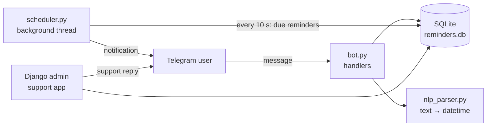

# Remindy — Smart Reminder Telegram Bot

[](https://github.com/smvpt/Remindy/actions/workflows/tests.yml)


[](LICENSE)

**English** | [Русский](README.ru.md)

A Telegram bot that turns plain-English messages like *"call mom in 2 hours"* into scheduled reminders.
It comes with a Django admin panel where you can see users, reminders and incoming messages, and reply to users.

```text
You:     meeting tomorrow at 15:00
Remindy: ✅ Reminder created!
         📝 meeting
         🗓 November 26, 2026 at 15:00 (Asia/Almaty)
```

<p align="center">
  
  
  
</p>

---

## Features

- **Natural-language reminders**: a regex-based parser built from scratch, with no date libraries (see [supported phrases](#supported-phrases)).
- **Clarifying dialog**: if you send only the text (`dentist`), the bot asks *when*. If you send only the time (`tomorrow at 10:00`), it asks *what*.
- **Urgent reminders**: messages with *urgent*, *important* or *asap* are delivered as highlighted notifications.
- **List, search and delete**: `/list` with inline delete buttons and "Clear all"; `/find` supports keywords **and regular expressions**.
- **Per-user timezones**: pick one from the inline keyboard. Times are stored in UTC and shown in the user's local time.
- **Survives restarts**: reminders live in SQLite, and the background scheduler picks up pending ones after a restart.
- **Extra tools**: current weather (OpenWeather API) and KZT exchange rates (National Bank of Kazakhstan RSS).
- **Django admin panel** (Jazzmin theme):
  - browse and edit **bot users** and **reminders**;
  - a log of every **user message**. Type an answer, press *Save*, and the user gets it in Telegram.

## Supported phrases

| Type | Examples |
|---|---|
| Relative | `in 30 minutes`, `in an hour`, `after 2 hours`, `in 3 days`, `in a week` |
| Day words | `today at 18:00`, `tomorrow at 9am`, `day after tomorrow` |
| Weekdays | `friday at 18:30`, `on mon at 10:00`, `next friday` (the week after) |
| Dates | `25.12.2026 at 10:30`, `25/12/2026` |
| Time only | `at 14:00`, `at 6pm`, `9:30` → today, or tomorrow if that time has passed |

The time can go anywhere in the message: `call mom in 2 hours` and `in 2 hours call mom` both work.
A date without a time defaults to 09:00.

## Commands

| Command | Description |
|---|---|
| `/start` | Register and show the main menu |
| `/help` | How to write reminders |
| `/list` | Active reminders with delete buttons |
| `/find <text or regex>` | Search reminders, e.g. `/find meeting` or `/find \d{2}:00` |
| `/weather <city>` | Current weather (defaults to Almaty) |
| `/rates` | USD, EUR, RUB and CNY rates to KZT |
| `/timezone` | Change your timezone |
| `/cancel` | Cancel the current dialog |

The same actions are available from the reply-keyboard menu.

---

## Quick start

**Requirements:** Python 3.10+, a bot token from [@BotFather](https://t.me/BotFather) and a free
[OpenWeather API key](https://home.openweathermap.org/api_keys) (only needed for `/weather`).

```bash
# 1. Clone
git clone https://github.com/smvpt/Remindy.git
cd Remindy

# 2. Create and activate a virtual environment
python -m venv venv
source venv/bin/activate        # Windows: venv\Scripts\activate

# 3. Install dependencies
pip install -r requirements.txt

# 4. Create your config from the template and fill in your tokens
cp config.example.py config.py  # Windows: copy config.example.py config.py

# 5. Create the database tables
python manage.py migrate

# 6. Run the bot
python bot.py
```

### Configuration (`config.py`)

| Setting | Description | Example |
|---|---|---|
| `BOT_TOKEN` | Telegram bot token from @BotFather | `"123456:ABC..."` |
| `WEATHER_API` | OpenWeather API key | `"a1b2c3..."` |
| `DEFAULT_TIMEZONE` | Timezone for new users (IANA name) | `"Asia/Almaty"` |
| `DB_PATH` | SQLite file shared by the bot and the admin panel | `"reminders.db"` |

`config.py` is listed in `.gitignore`, so your tokens never end up in git.

### Admin panel

```bash
python manage.py createsuperuser
python manage.py runserver
```

Open <http://127.0.0.1:8000/admin/>. The bot and the admin panel use the same SQLite file,
so run both at the same time to see new messages and reminders as they arrive.

For anything beyond local use, set the environment variables `DJANGO_SECRET_KEY`, `DJANGO_DEBUG=0` and
`DJANGO_ALLOWED_HOSTS`.

---

## How it works



1. `bot.py` gets a message. `nlp_parser.py` splits it into the reminder text and a timezone-aware `datetime`.
2. The reminder is saved to SQLite in UTC.
3. `scheduler.py` runs in a daemon thread. Every 10 seconds it sends the reminders that are due and marks them as sent.
4. Every message is also written to the `support_userquery` table, which the admin panel shows.

### Project structure

```text
Remindy/
├── bot.py              # Telegram handlers, keyboards, weather & rates
├── nlp_parser.py       # natural-language date/time parser (regex)
├── reminders.py        # reminder classes (OOP) and merge sort
├── scheduler.py        # background delivery loop
├── database.py         # SQLite access layer
├── config.example.py   # config template → copy to config.py
├── manage.py           # Django entry point
├── bot_admin/          # Django project (settings, urls)
├── support/            # Django app: models + admin for users, reminders, queries
├── tests/              # pytest test suite
├── screenshots/
├── requirements.txt
└── requirements-dev.txt
```

### Under the hood

- **OOP:** `ReminderBase` is an abstract class with a name-mangled private field and read-only properties.
  `SimpleReminder` and `UrgentReminder` override `format_message()` (polymorphism), and `make_reminder()` is a factory.
- **Algorithms:** reminders are sorted with a hand-written, stable **merge sort** (O(n log n)). `/find` matches regular expressions.
- **Safety:** user text is HTML-escaped before it goes into Telegram messages, SQL queries are parameterized,
  and every external API call has a timeout and error handling.

---

## Running tests

```bash
pip install -r requirements-dev.txt
pytest          # 54 tests: parser, sorting, OOP, database, scheduler, rates parsing
ruff check .    # lint
```

The tests need no `config.py`, no network and no bot token. GitHub Actions runs them on Python 3.10–3.12 for every push.

## Screenshots

| Weather | Exchange rates | Timezone |
|---|---|---|
|  |  |  |

**Django admin panel**


## Tech stack

Python · [pyTelegramBotAPI](https://github.com/eternnoir/pyTelegramBotAPI) · Django 4.2 + [Jazzmin](https://github.com/farridav/django-jazzmin) ·
SQLite · pytz · requests · BeautifulSoup4 + lxml · pytest · ruff · GitHub Actions

## License

[MIT](LICENSE) © Oleg Mukhin
