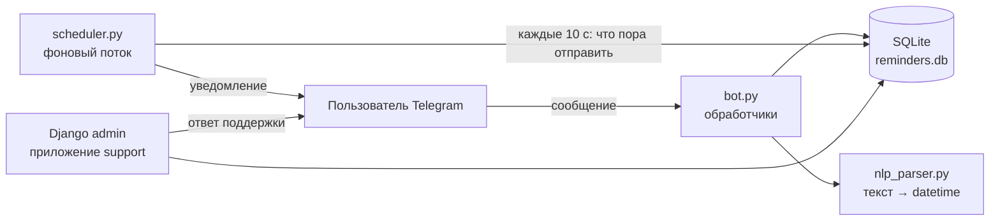

# Remindy — умный Telegram-бот для напоминаний

[](https://github.com/smvpt/Remindy/actions/workflows/tests.yml)


[](LICENSE)

[English](README.md) | **Русский**

Telegram-бот, который превращает обычные фразы вроде *«call mom in 2 hours»* в запланированные напоминания.
В комплекте есть админ-панель на Django: в ней видны пользователи, напоминания и входящие сообщения, и из неё можно отвечать пользователям.

```text
Вы:      meeting tomorrow at 15:00
Remindy: ✅ Reminder created!
         📝 meeting
         🗓 November 26, 2026 at 15:00 (Asia/Almaty)
```

> Интерфейс бота и распознавание фраз сейчас работают на английском языке.

<p align="center">
  
  
  
</p>

---

## Возможности

- **Напоминания на естественном языке**: собственный парсер на регулярных выражениях, без библиотек для работы с датами (см. [поддерживаемые фразы](#поддерживаемые-фразы)).
- **Уточняющий диалог**: если прислать только текст (`dentist`), бот спросит *когда*. Если прислать только время (`tomorrow at 10:00`), спросит *о чём* напомнить.
- **Срочные напоминания**: сообщения со словами *urgent*, *important*, *asap* или *срочно* приходят с выделением.
- **Список, поиск и удаление**: `/list` с inline-кнопками удаления и «Clear all»; `/find` ищет по ключевым словам **и регулярным выражениям**.
- **Часовой пояс у каждого пользователя**: выбирается на inline-клавиатуре. Время хранится в UTC, а показывается в местном времени пользователя.
- **Переживает перезапуск**: напоминания лежат в SQLite, и после рестарта фоновый планировщик подхватывает неотправленные.
- **Дополнительно**: погода (OpenWeather API) и курсы валют к тенге (RSS Национального банка РК).
- **Админ-панель на Django** (тема Jazzmin):
  - просмотр и редактирование **пользователей бота** и **напоминаний**;
  - журнал всех **сообщений пользователей**. Достаточно написать ответ и нажать *Save*: пользователь получит его в Telegram.

## Поддерживаемые фразы

| Тип | Примеры |
|---|---|
| Относительное время | `in 30 minutes`, `in an hour`, `after 2 hours`, `in 3 days`, `in a week` |
| Слова-дни | `today at 18:00`, `tomorrow at 9am`, `day after tomorrow` |
| Дни недели | `friday at 18:30`, `on mon at 10:00`, `next friday` (через неделю) |
| Даты | `25.12.2026 at 10:30`, `25/12/2026` |
| Только время | `at 14:00`, `at 6pm`, `9:30` → сегодня, а если это время уже прошло, то завтра |

Время можно писать в любом месте фразы: `call mom in 2 hours` и `in 2 hours call mom` работают одинаково.
Если указана дата без времени, напоминание ставится на 09:00.

## Команды

| Команда | Описание |
|---|---|
| `/start` | Регистрация и главное меню |
| `/help` | Как писать напоминания |
| `/list` | Активные напоминания с кнопками удаления |
| `/find <текст или regex>` | Поиск, например `/find meeting` или `/find \d{2}:00` |
| `/weather <город>` | Текущая погода (по умолчанию Алматы) |
| `/rates` | Курсы USD, EUR, RUB и CNY к тенге |
| `/timezone` | Сменить часовой пояс |
| `/cancel` | Отменить текущий диалог |

Те же действия есть в меню на клавиатуре.

---

## Быстрый старт

**Что понадобится:** Python 3.10+, токен бота от [@BotFather](https://t.me/BotFather) и бесплатный
[ключ OpenWeather](https://home.openweathermap.org/api_keys) (нужен только для `/weather`).

```bash
# 1. Клонировать репозиторий
git clone https://github.com/smvpt/Remindy.git
cd Remindy

# 2. Создать и активировать виртуальное окружение
python -m venv venv
source venv/bin/activate        # Windows: venv\Scripts\activate

# 3. Установить зависимости
pip install -r requirements.txt

# 4. Создать конфиг из шаблона и вписать свои токены
cp config.example.py config.py  # Windows: copy config.example.py config.py

# 5. Создать таблицы в базе
python manage.py migrate

# 6. Запустить бота
python bot.py
```

### Настройки (`config.py`)

| Параметр | Описание | Пример |
|---|---|---|
| `BOT_TOKEN` | Токен бота от @BotFather | `"123456:ABC..."` |
| `WEATHER_API` | Ключ OpenWeather | `"a1b2c3..."` |
| `DEFAULT_TIMEZONE` | Часовой пояс для новых пользователей (имя IANA) | `"Asia/Almaty"` |
| `DB_PATH` | Файл SQLite, общий для бота и админки | `"reminders.db"` |

`config.py` добавлен в `.gitignore`, так что токены не попадут в репозиторий.

### Админ-панель

```bash
python manage.py createsuperuser
python manage.py runserver
```

Откройте <http://127.0.0.1:8000/admin/>. Бот и админка работают с одним файлом SQLite,
поэтому если запустить их одновременно, новые сообщения и напоминания будут появляться в админке сразу.

Если админка нужна не только локально, задайте переменные окружения `DJANGO_SECRET_KEY`, `DJANGO_DEBUG=0` и `DJANGO_ALLOWED_HOSTS`.

---

## Как это устроено



1. `bot.py` получает сообщение. `nlp_parser.py` разделяет его на текст напоминания и `datetime` с учётом часового пояса.
2. Напоминание сохраняется в SQLite в UTC.
3. `scheduler.py` работает в фоновом потоке: каждые 10 секунд отправляет напоминания, срок которых наступил, и помечает их отправленными.
4. Каждое сообщение пользователя также записывается в таблицу `support_userquery`, которую показывает админка.

### Структура проекта

```text
Remindy/
├── bot.py              # обработчики Telegram, клавиатуры, погода и курсы
├── nlp_parser.py       # парсер даты и времени на естественном языке (regex)
├── reminders.py        # классы напоминаний (ООП) и сортировка слиянием
├── scheduler.py        # фоновая отправка напоминаний
├── database.py         # работа с SQLite
├── config.example.py   # шаблон конфига → скопировать в config.py
├── manage.py           # точка входа Django
├── bot_admin/          # Django-проект (settings, urls)
├── support/            # Django-приложение: модели и админка для пользователей, напоминаний, запросов
├── tests/              # тесты на pytest
├── screenshots/
├── requirements.txt
└── requirements-dev.txt
```

### Технические детали

- **ООП:** `ReminderBase` — абстрактный класс с приватным полем (name mangling) и свойствами только для чтения.
  `SimpleReminder` и `UrgentReminder` переопределяют `format_message()` (полиморфизм), а `make_reminder()` — фабрика.
- **Алгоритмы:** напоминания сортируются собственной устойчивой **сортировкой слиянием** (O(n log n)). `/find` ищет по регулярным выражениям.
- **Безопасность:** пользовательский текст экранируется перед вставкой в HTML-сообщения Telegram, SQL-запросы параметризованы,
  у всех запросов к внешним API есть таймауты и обработка ошибок.

---

## Тесты

```bash
pip install -r requirements-dev.txt
pytest          # 54 теста: парсер, сортировка, ООП, база данных, планировщик, разбор курсов
ruff check .    # линтер
```

Для тестов не нужны `config.py`, интернет и токен бота. GitHub Actions запускает их на Python 3.10–3.12 при каждом push.

## Скриншоты

| Погода | Курсы валют | Часовой пояс |
|---|---|---|
|  |  |  |

**Админ-панель Django**


## Стек

Python · [pyTelegramBotAPI](https://github.com/eternnoir/pyTelegramBotAPI) · Django 4.2 + [Jazzmin](https://github.com/farridav/django-jazzmin) ·
SQLite · pytz · requests · BeautifulSoup4 + lxml · pytest · ruff · GitHub Actions

## Лицензия

[MIT](LICENSE) © Олег Мухин
